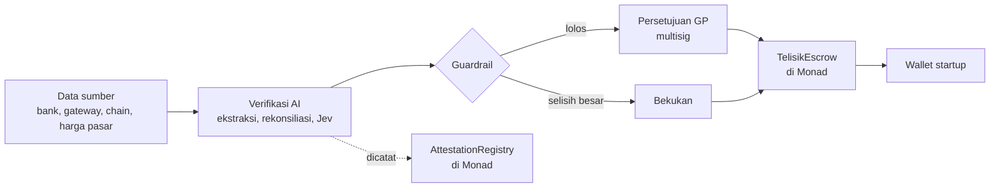

# Telisik

> Dana hanya cair kalau laporannya terbukti benar.

Telisik memeriksa setiap laporan keuangan dan setiap harga belanja terhadap data sumber yang tidak bisa diubah startup. Dana investasi dicairkan bertahap lewat escrow di [Monad](https://monad.xyz), dan hanya cair kalau lolos verifikasi dan disetujui GP. Pasar awalnya VC kripto. Pengadaan publik menjadi demo kedua.

**Status:** perencanaan, 13 Oktober 2026. "Telisik" masih nama kerja.

## Masalah

| Kasus | Yang terjadi | Pemeriksaan yang hilang |
| --- | --- | --- |
| eFishery (investor swasta) | Pendapatan Jan–Sep 2024 diduga dilaporkan sekitar 4,8x dari catatan internal | Laporan vs data sumber |
| Kaus kaki BGN untuk MBG (anggaran publik) | Pengadaan sekitar Rp6,9 miliar, hingga Rp100 ribu per pasang | Harga vs pasar |

Detail dan sumbernya ada di [docs/01-masalah.md](docs/01-masalah.md).

## Cara kerja singkat



Prinsipnya: **AI memeriksa, smart contract menjaga uang, manusia memutuskan, dan blockchain jadi saksi.**

## Mode deployment

Mesin verifikasi tidak bergantung pada Monad. Hanya escrow dan catatan audit yang bergantung pada chain, dan keduanya dipasang lewat adapter.

| Mode | Uang | Catatan audit | Untuk |
| --- | --- | --- | --- |
| A. Monad (versi hackathon) | TelisikEscrow, USDC | AttestationRegistry | VC kripto, hibah ekosistem |
| B. Chain EVM lain | Kontrak yang sama | Kontrak yang sama | VC kripto di ekosistem lain |
| C. Tanpa blockchain | Rekening escrow bank kustodian | Log bertanda tangan elektronik + cap waktu | VC tradisional, CVC BUMN, pasar Indonesia |

Detail dan antarmukanya ada di [03 Arsitektur, Mode deployment](docs/03-arsitektur.md#mode-deployment).

## Dokumentasi

| Dokumen | Isi |
| --- | --- |
| [01 Masalah](docs/01-masalah.md) | Kasus eFishery, kaus kaki MBG, TaniHub, dan celah pemeriksaannya |
| [02 Solusi dan cara kerja](docs/02-solusi-dan-cara-kerja.md) | Empat modul, prinsip desain, contoh skenario AquaTech |
| [03 Arsitektur](docs/03-arsitektur.md) | Diagram komponen, diagram urutan, mode deployment (Monad, EVM lain, tanpa blockchain) |
| [04 Sumber data](docs/04-sumber-data.md) | Data yang dipakai, cara akses, fase |
| [05 Smart contract](docs/05-smart-contract.md) | Spesifikasi TelisikEscrow dan AttestationRegistry |
| [06 Mesin verifikasi](docs/06-mesin-verifikasi.md) | Pemeriksaan, ambang, peran Jev, guardrail |
| [07 Pasar dan bisnis](docs/07-pasar-dan-bisnis.md) | Segmen, model bisnis, kompetitor, catatan Danantara |
| [08 Risiko](docs/08-risiko.md) | Risiko teknis, hukum, bisnis, dan mitigasinya |
| [09 Roadmap](docs/09-roadmap.md) | Fase, gerbang keputusan, checklist |
| [10 Pitch deck](docs/10-pitch-deck.md) | Susunan slide |
| [Glosarium](docs/glosarium.md) | VC, GP, LP, tranche, escrow, multisig, dan istilah lain |

## Rencana struktur repo

Folder kode belum dibuat. Rencananya:

```
telisik/
├── docs/          dokumen perencanaan (sudah ada)
├── contracts/     TelisikEscrow dan AttestationRegistry (Solidity, Foundry)
├── verifier/      mesin verifikasi: ekstraksi, rekonsiliasi, Jev, guardrail (TypeScript)
├── dashboard/     dashboard GP dan LP
└── demo-data/     data fiktif: startup jujur, startup "ala eFishery", data pengadaan
```

## Karya terkait

Pola keputusan Jev + guardrail + pembayaran x402 diuji lebih dulu di prototipe `warung-agents`. Prototipe ini merupakan port ke Monad Testnet dari workshop [cathlynshanice/warung-agents](https://github.com/cathlynshanice/warung-agents).

## Jaringan

| | Monad Testnet | Monad Mainnet |
| --- | --- | --- |
| Chain ID | 10143 | 143 |
| USDC | `0x534b2f3A21130d7a60830c2Df862319e593943A3` | `0x754704Bc059F8C67012fEd69BC8A327a5aafb603` |
| Explorer | [testnet.monadvision.com](https://testnet.monadvision.com) | |

Sumber: [Monad Docs, x402](https://docs.monad.xyz/guides/x402) dan [Monad Docs, testnet](https://docs.monad.xyz/developer-essentials/testnets).
