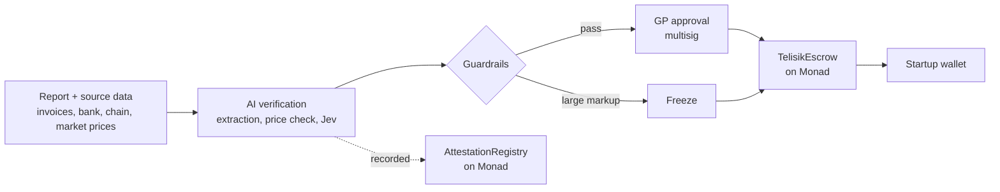

# Telisik

[Bahasa Indonesia](README.id.md) · **English**

> Investor money moves only when the numbers are true.

Telisik ("to examine closely" in Indonesian) checks every spending report and every line-item price against reality. Investor funds are released in tranches from an escrow on [Monad](https://monad.xyz), and only after verification passes and the GP approves. The first market is crypto VCs. Public procurement is the second demo.

**Status:** planning and MVP build during the Monad Metropolis hackathon (October 2026). "Telisik" is a working name.

## Problem

Startups spend investor money and report it back, and nobody checks those reports against reality. A bottle that costs Rp10,000 can be reported as Rp500,000, and the gap disappears through a friendly vendor.

| Case | What happened | Missing check |
| --- | --- | --- |
| Spending markup (example) | A Rp10,000 bottle reported at Rp500,000 each (50x) | Line-item price vs market |
| eFishery (private investors) | Jan–Sep 2024 revenue reportedly overstated about 4.8x versus internal records | Report vs source data |
| Socks bought by BGN for the MBG program (public budget) | About Rp6.9B of socks, at up to Rp100k per pair | Price vs market |

Details and sources: [docs/en/01-problem.md](docs/en/01-problem.md).

## How it works



The principle: **AI checks, the smart contract guards the money, humans decide, and the blockchain is the witness.** Markups are flagged, not judged: the startup can explain (custom printing, remote shipping), and the GP's decision and reason are recorded onchain.

## Deployment modes

The verification engine does not depend on Monad. Only the escrow and the audit log touch a chain, and both plug in through adapters.

| Mode | Money | Audit log | For |
| --- | --- | --- | --- |
| A. Monad (hackathon version) | TelisikEscrow, USDC | AttestationRegistry | Crypto VCs, ecosystem grants |
| B. Another EVM chain | Same contracts | Same contracts | Crypto VCs on other ecosystems |
| C. No blockchain | Escrow account at a custodian bank | Electronically signed, timestamped log | Traditional VCs, state-owned CVCs, Indonesian market |

Details and interfaces: [03 Architecture, Deployment modes](docs/en/03-architecture.md#deployment-modes).

## Documentation

| Document | Contents |
| --- | --- |
| [01 Problem](docs/en/01-problem.md) | eFishery, MBG socks, TaniHub, and the missing checks |
| [02 Solution and how it works](docs/en/02-solution-and-how-it-works.md) | Four modules, design principles, the AquaTech walkthrough |
| [03 Architecture](docs/en/03-architecture.md) | Component diagram, sequence diagram, deployment modes (Monad, other EVM, no blockchain) |
| [04 Data sources](docs/en/04-data-sources.md) | Data used, how it is accessed, which phase |
| [05 Smart contracts](docs/en/05-smart-contracts.md) | TelisikEscrow and AttestationRegistry spec |
| [06 Verification engine](docs/en/06-verification-engine.md) | Checks, thresholds, Jev's role, guardrails |
| [07 Market and business](docs/en/07-market-and-business.md) | Segments, business model, competitors, note on Danantara |
| [08 Risks](docs/en/08-risks.md) | Technical, legal and business risks with mitigations |
| [09 Roadmap](docs/en/09-roadmap.md) | Phases, decision gates, checklist |
| [10 Pitch deck](docs/en/10-pitch-deck.md) | Slide outline |
| [Glossary](docs/en/glossary.md) | VC, GP, LP, tranche, escrow, multisig and other terms |

Indonesian versions are in [docs/id/](docs/id/).

## Planned repo layout

Code folders are not created yet. The plan:

```
telisik/
├── docs/
│   ├── en/        English documents
│   └── id/        Indonesian documents
├── contracts/     TelisikEscrow and AttestationRegistry (Solidity, Foundry)
├── verifier/      verification engine: extraction, price check, Jev, guardrails (TypeScript)
├── dashboard/     GP and LP dashboard
└── demo-data/     fictional data: honest report, marked-up report, procurement data
```

## Related work

The Jev + guardrails + x402 payment pattern was first tested in the `warung-agents` prototype, a Monad Testnet port of the [cathlynshanice/warung-agents](https://github.com/cathlynshanice/warung-agents) workshop.

## Network

| | Monad Testnet | Monad Mainnet |
| --- | --- | --- |
| Chain ID | 10143 | 143 |
| USDC | `0x534b2f3A21130d7a60830c2Df862319e593943A3` | `0x754704Bc059F8C67012fEd69BC8A327a5aafb603` |
| Explorer | [testnet.monadvision.com](https://testnet.monadvision.com) | |

Sources: [Monad Docs, x402](https://docs.monad.xyz/guides/x402) and [Monad Docs, testnets](https://docs.monad.xyz/developer-essentials/testnets).
