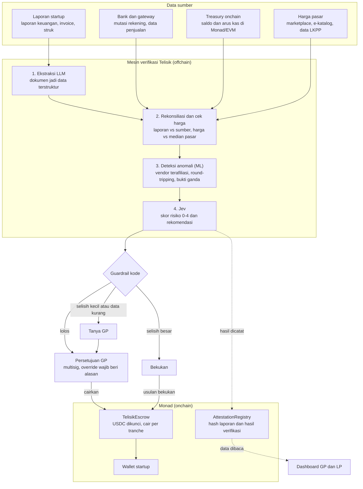
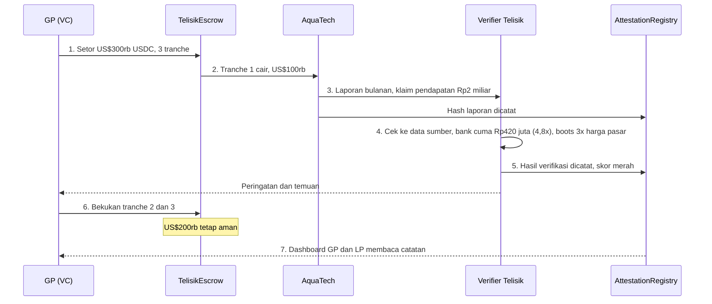
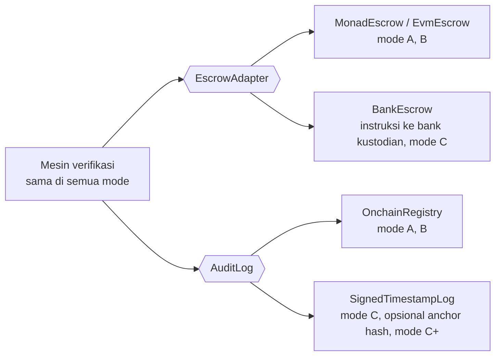

# 03 Arsitektur

Dana hanya cair setelah verifikasi lolos dan GP menyetujui. Data asli tetap offchain. Monad menyimpan hash, hasil verifikasi, dan dana USDC.

## Diagram komponen



## Komponen

| Komponen | Lokasi | Tanggung jawab | Teknologi (rencana) |
| --- | --- | --- | --- |
| Konektor data | Offchain | Menarik data bank, gateway, chain, dan harga dengan akses read-only | TypeScript, API agregator, viem |
| Ekstraksi | Offchain | Mengubah PDF dan gambar jadi JSON dengan skema tetap | LLM (Qwen atau Kimi) |
| Rekonsiliasi dan cek harga | Offchain | Menghitung rasio dan selisih secara deterministik | TypeScript |
| Deteksi anomali | Offchain | Mencari pola janggal di arus kas dan vendor | Python (scikit-learn) |
| Jev | Offchain (API) | Skor risiko dan rekomendasi tindakan beserta probabilitas | `@typesafe-ai/sdk` |
| Guardrail | Offchain | Aturan keras yang menimpa rekomendasi AI | TypeScript |
| AttestationRegistry | Monad | Catatan permanen hasil verifikasi | Solidity |
| TelisikEscrow | Monad | Mengunci dan mencairkan USDC per tranche | Solidity |
| Dashboard | Web | Status tranche, temuan, dan aliran dana untuk GP dan LP | Next.js |

## Diagram urutan: contoh AquaTech

Nama dan angka fiktif. Penjelasan tiap langkahnya ada di [02 Solusi dan cara kerja](02-solusi-dan-cara-kerja.md#contoh-skenario-aquatech).



## Mode deployment

Mesin verifikasi (ekstraksi, rekonsiliasi, anomali, Jev, guardrail) tidak bergantung pada chain mana pun. Hanya dua komponen yang bergantung pada blockchain, yaitu escrow dan catatan audit, dan keduanya bisa diganti tanpa mengubah mesin verifikasi.

| Mode | Uang disimpan di | Catatan audit | Cocok untuk |
| --- | --- | --- | --- |
| A. Monad | TelisikEscrow (USDC) | AttestationRegistry | VC kripto, hibah ekosistem Monad |
| B. Chain EVM lain | Kontrak yang sama di Ethereum, Base, Arbitrum, dll. | Kontrak yang sama | VC kripto di ekosistem lain |
| C. Tanpa blockchain | Rekening escrow di bank kustodian (rupiah atau dolar) | Log append-only, ditandatangani dengan tanda tangan elektronik tersertifikasi dan diberi cap waktu independen | VC tradisional, CVC BUMN, pasar Indonesia |
| C+. Hibrida | Rekening escrow bank | Seperti mode C, plus hash dicatat di chain publik sebagai bukti tambahan | Klien yang ingin bukti publik tanpa memindahkan uang ke chain |



### Antarmuka

Mesin verifikasi hanya memanggil dua antarmuka ini. Mode dipilih lewat konfigurasi.

```ts
interface EscrowAdapter {
  release(dealId: string, tranche: number): Promise<Receipt>;
  freeze(dealId: string, reason: string): Promise<Receipt>;
  refund(dealId: string): Promise<Receipt>;
  status(dealId: string): Promise<DealStatus>;
}

interface AuditLog {
  record(subject: string, dataHash: string, result: VerificationResult): Promise<Proof>;
  verify(proof: Proof): Promise<boolean>; // siapa pun bisa mengecek catatan tidak diubah
}

// Implementasi:
//   Mode A/B: MonadEscrow, EvmEscrow (chain EVM apa pun), OnchainRegistry
//   Mode C:   BankEscrow (instruksi ke bank kustodian), SignedTimestampLog
//   Mode C+:  BankEscrow + SignedTimestampLog yang juga mencatat hash ke chain publik
```

### Yang berubah tanpa blockchain

- **Escrow butuh perantara berizin.** Pencairan berupa instruksi ke bank kustodian atau wali amanat, dengan biaya dan waktu proses dalam hitungan hari.
- **Kepercayaan pada catatan audit** berpindah ke penyedia tanda tangan elektronik dan cap waktu, bukan jaringan publik.
- **Telisik tidak pernah memegang uang klien.** Di semua mode, dana berada di kontrak escrow atau rekening escrow lembaga berizin, bukan di rekening Telisik.

### Catatan untuk hackathon dan grant

Versi hackathon memakai mode A. Sebelum menerima grant atau residency dari Monad Foundation, cek kewajibannya di Rules & Guidelines (hak kekayaan intelektual, komitmen membangun di Monad), dan sampaikan secara terbuka bahwa Telisik dirancang multi-mode.
