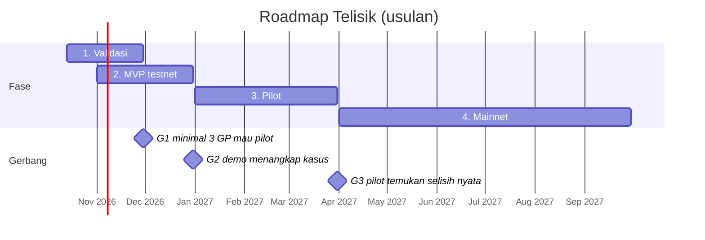

# 09 Roadmap

Mainnet berbayar paling cepat April 2027, setelah tiga gerbang keputusan lolos. Jadwal ini usulan, dihitung dari 13 Oktober 2026.

| Fase | Waktu | Isi | Gerbang untuk lanjut |
| --- | --- | --- | --- |
| 1. Validasi | Okt–Nov 2026 | Wawancara 10 GP dan 5 founder | G1: minimal 3 GP mau ikut pilot |
| 2. MVP testnet | Nov–Des 2026 | Escrow, verifier, dashboard, demo | G2: demo menangkap kasus "ala eFishery" dan harga janggal |
| 3. Pilot | Jan–Mar 2027 | 1–2 VC kripto, data read-only | G3: pilot menemukan selisih nyata, 1 pelanggan mau membayar |
| 4. Mainnet | Apr–Sep 2027 | Audit kontrak, integrasi bank, pelanggan berbayar | |

Kalau gerbang 1 gagal karena GP tidak tertarik, segmen pertama diganti dulu sebelum membangun MVP.

## Checklist langkah berikutnya

- [ ] Wawancarai 10 GP atau analis VC (kripto dan tradisional): cara mereka memantau portofolio sekarang, jam kerja per bulan, dan kapan mereka pernah tertipu laporan
- [ ] Wawancarai 5 founder: data apa yang rela mereka buka dan dalam bentuk apa
- [ ] Cari 1–2 akselerator atau VC kripto yang mau jadi mitra pilot (akses data read-only)
- [ ] Bangun TelisikEscrow dan AttestationRegistry di Monad testnet, beserta tes
- [ ] Bangun verifier: rekonsiliasi pendapatan vs mutasi, cek harga vs pasar, Jev, dan guardrail
- [ ] Siapkan dataset demo: startup jujur, startup "ala eFishery", dan data pengadaan kaus kaki dari LKPP
- [ ] Bangun dashboard GP/LP: status tranche, temuan, aliran dana
- [ ] Buat pitch deck dan video demo 3 menit
- [ ] Konsultasi hukum: UU PDP, UU ITE, status escrow USDC untuk pengguna Indonesia
- [ ] Pantau hackathon Monad berikutnya dan program [Monad Founder Residency](https://residency.monad.xyz/)
