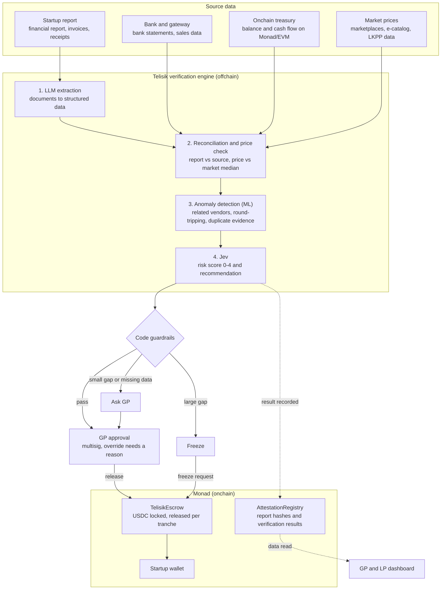
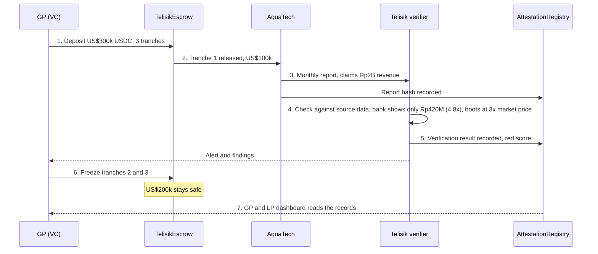
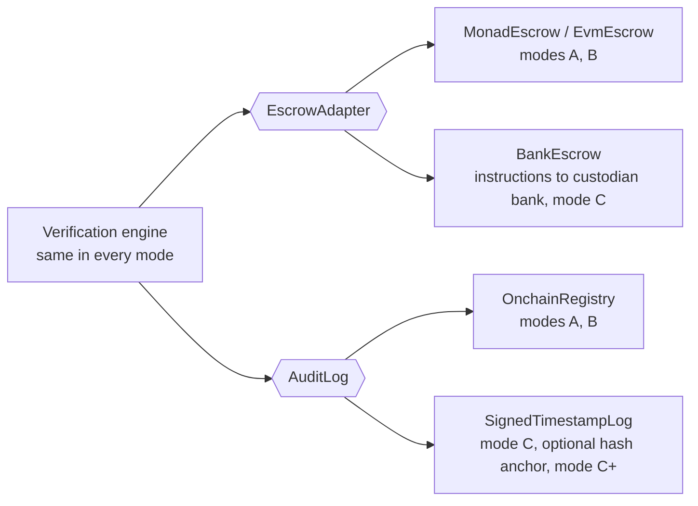

# 03 Architecture

[Bahasa Indonesia](../id/03-arsitektur.md) · **English**

Funds are released only after verification passes and the GP approves. Raw data stays offchain. Monad stores hashes, verification results and the USDC funds.

## Component diagram



## Components

| Component | Where | Responsibility | Technology (planned) |
| --- | --- | --- | --- |
| Data connectors | Offchain | Pull bank, gateway, chain and price data with read-only access | TypeScript, aggregator APIs, viem |
| Extraction | Offchain | Turn PDFs and images into JSON with a fixed schema | LLM (Qwen or Kimi) |
| Reconciliation and price check | Offchain | Compute ratios and gaps deterministically | TypeScript |
| Anomaly detection | Offchain | Find odd patterns in cash flow and vendors | Python (scikit-learn) |
| Jev | Offchain (API) | Risk score and recommended action with probabilities | `@typesafe-ai/sdk` |
| Guardrails | Offchain | Hard rules that override AI recommendations | TypeScript |
| AttestationRegistry | Monad | Permanent record of verification results | Solidity |
| TelisikEscrow | Monad | Lock and release USDC per tranche | Solidity |
| Dashboard | Web | Tranche status, findings and fund flow for GPs and LPs | Next.js |

## Sequence diagram: AquaTech example

Fictional names and numbers. Each step is explained in [02 Solution and how it works](02-solution-and-how-it-works.md#example-walkthrough-aquatech).



## Deployment modes

The verification engine (extraction, reconciliation, anomaly detection, Jev, guardrails) does not depend on any chain. Only two components depend on a blockchain, the escrow and the audit log, and both can be swapped without changing the engine.

| Mode | Money held in | Audit log | For |
| --- | --- | --- | --- |
| A. Monad | TelisikEscrow (USDC) | AttestationRegistry | Crypto VCs, Monad ecosystem grants |
| B. Another EVM chain | Same contracts on Ethereum, Base, Arbitrum, etc. | Same contracts | Crypto VCs on other ecosystems |
| C. No blockchain | Escrow account at a custodian bank (rupiah or dollars) | Append-only log, signed with certified electronic signatures and independent timestamps | Traditional VCs, state-owned CVCs, Indonesian market |
| C+. Hybrid | Bank escrow account | As in mode C, plus hashes anchored on a public chain as extra proof | Clients who want public proof without moving money onchain |



### Interfaces

The engine only calls these two interfaces. The mode is chosen in configuration.

```ts
interface EscrowAdapter {
  release(dealId: string, tranche: number): Promise<Receipt>;
  freeze(dealId: string, reason: string): Promise<Receipt>;
  refund(dealId: string): Promise<Receipt>;
  status(dealId: string): Promise<DealStatus>;
}

interface AuditLog {
  record(subject: string, dataHash: string, result: VerificationResult): Promise<Proof>;
  verify(proof: Proof): Promise<boolean>; // anyone can check a record was not changed
}

// Implementations:
//   Modes A/B: MonadEscrow, EvmEscrow (any EVM chain), OnchainRegistry
//   Mode C:    BankEscrow (instructions to a custodian bank), SignedTimestampLog
//   Mode C+:   BankEscrow + SignedTimestampLog that also anchors hashes on a public chain
```

### What changes without a blockchain

- **The escrow needs a licensed intermediary.** A release becomes an instruction to a custodian bank or trustee, with fees and processing measured in days.
- **Trust in the audit log** moves to the electronic signature and timestamp providers instead of a public network.
- **Telisik never holds client money.** In every mode, funds sit in an escrow contract or an escrow account at a licensed institution, never in Telisik's own account.

### Note for the hackathon and grants

The hackathon version uses mode A. Before accepting a grant or residency from the Monad Foundation, check its obligations in the Rules & Guidelines (intellectual property, commitments to build on Monad), and say openly that Telisik is designed to run in several modes.
