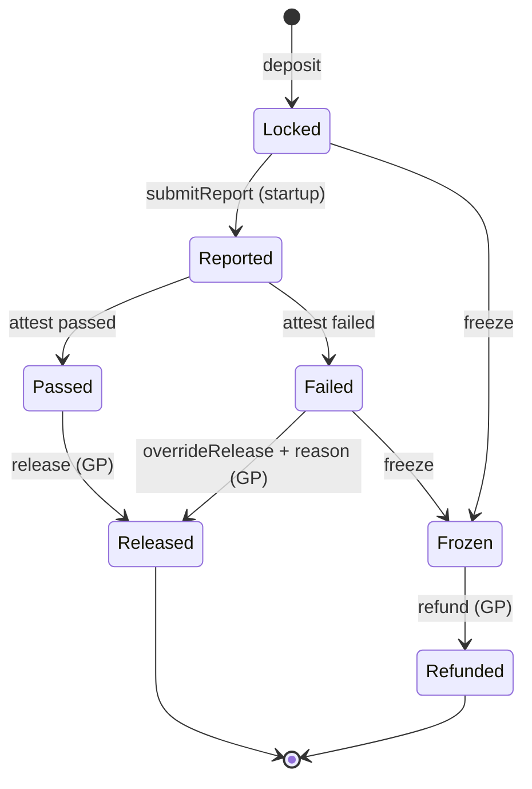

# 05 Smart contracts

[Bahasa Indonesia](../id/05-smart-contract.md) · **English**

Two contracts on Monad. **TelisikEscrow** holds the funds and releases them per tranche. **AttestationRegistry** permanently records every verification result.

## Network and token

| | Monad Testnet | Monad Mainnet |
| --- | --- | --- |
| Chain ID | 10143 | 143 |
| USDC | `0x534b2f3A21130d7a60830c2Df862319e593943A3` | `0x754704Bc059F8C67012fEd69BC8A327a5aafb603` |
| Public RPC | `https://testnet-rpc.monad.xyz` | |
| Explorer | [testnet.monadvision.com](https://testnet.monadvision.com) | |
| Faucet | MON: [faucet.monad.xyz](https://faucet.monad.xyz), USDC: [faucet.circle.com](https://faucet.circle.com) | |

Sources: [Monad Docs, x402](https://docs.monad.xyz/guides/x402) and [Monad Docs, testnets](https://docs.monad.xyz/developer-essentials/testnets).

## Roles

| Role | Can | Cannot |
| --- | --- | --- |
| GP (multisig) | Create deals, deposit, release tranches that passed, freeze, override with a recorded reason | Release without an attestation, except through a publicly recorded override |
| Startup | Submit a report hash per tranche, receive funds | Release funds to itself, change a report already submitted |
| Telisik verifier | Write attestations (pass/fail, score, result hash), request a freeze | Move funds |
| LP | Read deal status and attestations | Change anything |

The separation is deliberate: the verifier cannot move money, and the GP cannot quietly ignore verification results.

## Tranche states



## Interfaces (draft)

```solidity
// SPDX-License-Identifier: UNLICENSED
pragma solidity ^0.8.24;

interface ITelisikEscrow {
    event DealCreated(uint256 indexed dealId, address indexed gp, address indexed startup, address token, uint256 total);
    event Deposited(uint256 indexed dealId, uint256 amount);
    event ReportSubmitted(uint256 indexed dealId, uint256 indexed tranche, bytes32 reportHash);
    event Attested(uint256 indexed dealId, uint256 indexed tranche, bool passed, uint8 riskScore, bytes32 resultHash);
    event Released(uint256 indexed dealId, uint256 indexed tranche, uint256 amount);
    event OverrideReleased(uint256 indexed dealId, uint256 indexed tranche, string reason);
    event Frozen(uint256 indexed dealId, string reason);
    event Refunded(uint256 indexed dealId, uint256 amount);

    function createDeal(address startup, address token, uint256[] calldata trancheAmounts) external returns (uint256 dealId);
    function deposit(uint256 dealId, uint256 amount) external;
    function submitReport(uint256 dealId, uint256 tranche, bytes32 reportHash) external;                    // startup
    function attest(uint256 dealId, uint256 tranche, bool passed, uint8 riskScore, bytes32 resultHash) external; // verifier
    function release(uint256 dealId, uint256 tranche) external;                                              // GP, requires a passing attestation
    function overrideRelease(uint256 dealId, uint256 tranche, string calldata reason) external;              // GP, reason recorded
    function freeze(uint256 dealId, string calldata reason) external;                                        // GP or verifier request
    function refund(uint256 dealId) external;                                                                // GP, after a freeze
}

interface IAttestationRegistry {
    event Recorded(bytes32 indexed subject, bytes32 dataHash, bytes32 resultHash, uint8 riskScore, string model, uint64 timestamp);

    /// subject = hash(dealId, tranche) or hash(procurement package id)
    /// model   = name and version of the decision model, e.g. "jev-1.13-free"
    function record(bytes32 subject, bytes32 dataHash, bytes32 resultHash, uint8 riskScore, string calldata model) external;
}
```

## Security notes

- Contracts stay small and simple. No upgradeability in the MVP.
- Use `SafeERC20`, checks-effects-interactions and a reentrancy guard.
- Role-based access control. The GP address is a multisig.
- A value cap per deal during the pilot.
- Audit before mainnet. Availability of an audited multisig (e.g. Safe) on Monad must be checked first.
- In the MVP, a two-address multisig on testnet is enough.
