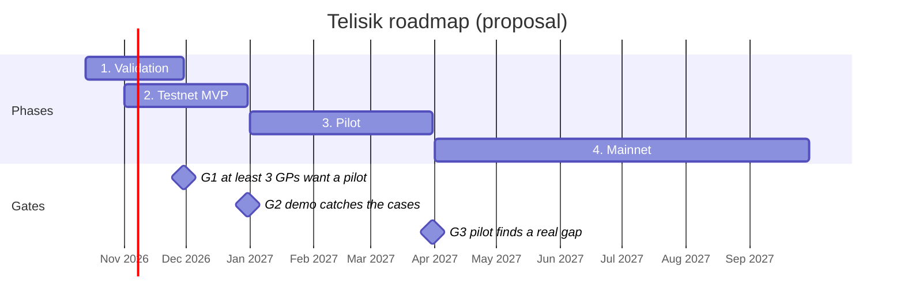

# 09 Roadmap

[Bahasa Indonesia](../id/09-roadmap.md) · **English**

Paid mainnet use is possible from April 2027 at the earliest, after three decision gates pass. This schedule is a proposal, counted from 13 October 2026.

| Phase | When | What | Gate to continue |
| --- | --- | --- | --- |
| 1. Validation | Oct–Nov 2026 | Interview 10 GPs and 5 founders | G1: at least 3 GPs want to join a pilot |
| 2. Testnet MVP | Nov–Dec 2026 | Escrow, verifier, dashboard, demo | G2: the demo catches an eFishery-style case and abnormal prices |
| 3. Pilot | Jan–Mar 2027 | 1–2 crypto VCs, read-only data | G3: the pilot finds a real gap and 1 customer is willing to pay |
| 4. Mainnet | Apr–Sep 2027 | Contract audit, bank integration, paying customers | |

If gate 1 fails because GPs are not interested, change the first segment before building the MVP.

## Next steps checklist

- [ ] Interview 10 GPs or VC analysts (crypto and traditional): how they monitor portfolios today, hours per month, and when they were misled by a report
- [ ] Interview 5 founders: what data they are willing to share and in what form
- [ ] Find 1–2 accelerators or crypto VCs willing to be pilot partners (read-only data access)
- [ ] Build TelisikEscrow and AttestationRegistry on Monad testnet, with tests
- [ ] Build the verifier: revenue vs bank reconciliation, price vs market check, Jev and guardrails
- [ ] Prepare demo data: an honest startup, a marked-up report, and sock procurement data from LKPP
- [ ] Build the GP/LP dashboard: tranche status, findings, fund flow
- [ ] Make the pitch deck and a 3-minute demo video
- [ ] Legal consultation: UU PDP, UU ITE, status of USDC escrow for Indonesian users
- [ ] Watch for the next Monad hackathon and the [Monad Founder Residency](https://residency.monad.xyz/)
