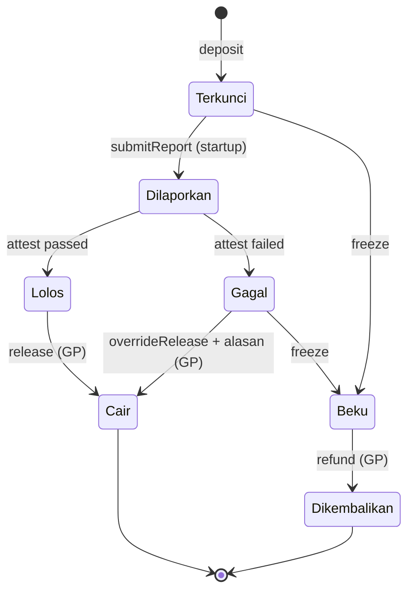

# 05 Smart contract

**Bahasa Indonesia** · [English](../en/05-smart-contracts.md)

Dua kontrak di Monad. **TelisikEscrow** menahan dana dan mencairkannya per tranche. **AttestationRegistry** mencatat setiap hasil verifikasi secara permanen.

## Jaringan dan token

| | Monad Testnet | Monad Mainnet |
| --- | --- | --- |
| Chain ID | 10143 | 143 |
| USDC | `0x534b2f3A21130d7a60830c2Df862319e593943A3` | `0x754704Bc059F8C67012fEd69BC8A327a5aafb603` |
| RPC publik | `https://testnet-rpc.monad.xyz` | |
| Explorer | [testnet.monadvision.com](https://testnet.monadvision.com) | |
| Faucet | MON: [faucet.monad.xyz](https://faucet.monad.xyz), USDC: [faucet.circle.com](https://faucet.circle.com) | |

Sumber: [Monad Docs, x402](https://docs.monad.xyz/guides/x402) dan [Monad Docs, testnet](https://docs.monad.xyz/developer-essentials/testnets).

## Peran

| Peran | Boleh | Tidak boleh |
| --- | --- | --- |
| GP (multisig) | Membuat deal, menyetor, mencairkan tranche yang lolos, membekukan, override dengan alasan tercatat | Mencairkan tanpa atestasi, kecuali lewat override yang tercatat publik |
| Startup | Mengirim hash laporan per tranche, menerima dana | Mencairkan sendiri, mengubah laporan yang sudah dikirim |
| Verifier Telisik | Menulis atestasi (lolos/gagal, skor, hash hasil), mengusulkan pembekuan | Memindahkan dana |
| LP | Membaca status deal dan atestasi | Mengubah apa pun |

Pemisahan peran ini disengaja: verifier tidak bisa memindahkan uang, dan GP tidak bisa diam-diam mengabaikan hasil verifikasi.

## Status tranche



## Antarmuka (draf)

```solidity
// SPDX-License-Identifier: UNLICENSED
pragma solidity ^0.8.24;

interface ITelisikEscrow {
    event DealCreated(uint256 indexed dealId, address indexed gp, address indexed startup, address token, uint256 total);
    event Deposited(uint256 indexed dealId, uint256 amount);
    event ReportSubmitted(uint256 indexed dealId, uint256 indexed tranche, bytes32 reportHash);
    event Attested(uint256 indexed dealId, uint256 indexed tranche, bool passed, uint8 riskScore, bytes32 resultHash);
    event Released(uint256 indexed dealId, uint256 indexed tranche, uint256 amount);
    event OverrideReleased(uint256 indexed dealId, uint256 indexed tranche, string reason);
    event Frozen(uint256 indexed dealId, string reason);
    event Refunded(uint256 indexed dealId, uint256 amount);

    function createDeal(address startup, address token, uint256[] calldata trancheAmounts) external returns (uint256 dealId);
    function deposit(uint256 dealId, uint256 amount) external;
    function submitReport(uint256 dealId, uint256 tranche, bytes32 reportHash) external;                    // startup
    function attest(uint256 dealId, uint256 tranche, bool passed, uint8 riskScore, bytes32 resultHash) external; // verifier
    function release(uint256 dealId, uint256 tranche) external;                                              // GP, wajib atestasi lolos
    function overrideRelease(uint256 dealId, uint256 tranche, string calldata reason) external;              // GP, alasan tercatat
    function freeze(uint256 dealId, string calldata reason) external;                                        // GP atau usulan verifier
    function refund(uint256 dealId) external;                                                                // GP, setelah freeze
}

interface IAttestationRegistry {
    event Recorded(bytes32 indexed subject, bytes32 dataHash, bytes32 resultHash, uint8 riskScore, string model, uint64 timestamp);

    /// subject = hash(dealId, tranche) atau hash(id paket pengadaan)
    /// model   = nama dan versi model keputusan, mis. "jev-1.13-free"
    function record(bytes32 subject, bytes32 dataHash, bytes32 resultHash, uint8 riskScore, string calldata model) external;
}
```

## Catatan keamanan

- Kontrak dibuat kecil dan sederhana. Tidak ada upgradeability di MVP.
- Pakai `SafeERC20`, pola checks-effects-interactions, dan penjaga reentrancy.
- Kontrol akses per peran. Alamat GP adalah multisig.
- Batas nilai per deal selama pilot.
- Audit sebelum mainnet. Ketersediaan multisig teraudit (mis. Safe) di Monad perlu dicek dulu.
- Di MVP, multisig cukup dua alamat wallet testnet.
